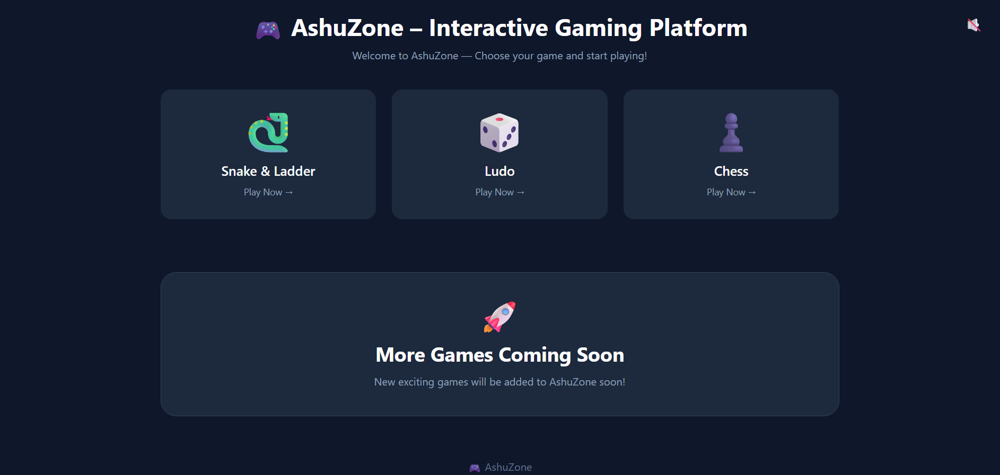

# 🎮 AshuZone – Interactive Gaming Platform

**AshuZone** is a React-based interactive gaming platform where users can enjoy multiple games in one place through a simple and engaging interface.

The platform brings classic games together to provide an enjoyable gaming experience.

## ✨ Features

- 🏠 **Home Page** – A central place to explore available games.
- ♟️ **Chess** – Play chess and enjoy strategic gameplay.
- 🎲 **Ludo** – Enjoy the classic Ludo board game.
- 🐍 **Snake & Ladder** – Play the traditional Snake and Ladder game.
- 🎨 **Interactive UI** – Simple and engaging user interface.
- 🔊 **Sound Effects** – Audio effects for an enhanced gaming experience.
- 🚀 **More Games Coming Soon!**

## 🛠️ Technologies Used

- React.js
- JavaScript
- HTML5
- CSS3
- Vite
- Git & GitHub

## 📂 Project Structure

``` text
AshuZone/
├── public/
│   ├── sounds/
│   │   ├── dice.mp4
│   │   ├── ludobg.mp3
│   │   ├── move.mp4
│   │   └── win.mp4
│   ├── favicon.svg
│   └── icons.svg
├── src/
│   ├── assets/
│   ├── components/
│   │   └── GameIntro.jsx
│   ├── games/
│   │   ├── screenshots/
│   │   │   └── main-page.png
│   │   ├── Chess.jsx
│   │   ├── ComputerSetup.jsx
│   │   ├── Ludo.jsx
│   │   ├── LudoBoard.jsx
│   │   └── SnakeLadder.jsx
│   ├── pages/
│   │   └── Home.jsx
│   ├── App.css
│   ├── App.jsx
│   ├── index.css
│   ├── main.jsx
│   ├── playSound.js
│   └── SnakeLadder.css
├── .gitignore
├── eslint.config.js
├── index.html
├── package-lock.json
├── package.json
├── README.md
└── vite.config.js
```

## ⚙️ Installation & Setup

Follow these steps to run the project locally.

**1. Clone the repository**

```bash
git clone https://github.com/Ashutiwa03/AshuZone-Interactive-Gaming-Platform.git
```

**2. Navigate to the project folder**

```bash
cd AshuZone-Interactive-Gaming-Platform
```

**3. Install dependencies**

```bash
npm install
```

**4. Start the development server**

```bash
npm run dev
```

**5. Open in browser**

Visit the local URL displayed in your terminal, usually:

```text
http://localhost:5173/
```

## 🎯 Future Improvements

- Add more interactive games.
- Improve the gaming experience.
- Introduce additional game modes.
- Enhance the user interface.

## 📸 Screenshot



## 👨‍💻 Author

**Ashutosh Tiwari**

GitHub: https://github.com/Ashutiwa03

---

⭐ If you like this project, don't forget to star the repository!

**AshuZone – Play. Enjoy. Repeat!** 🎮